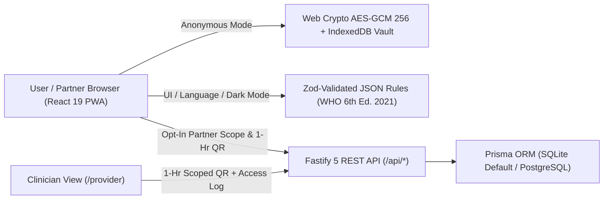
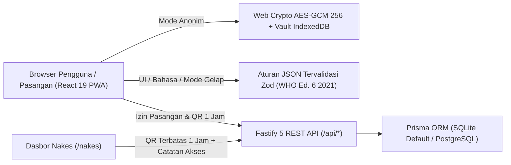

<div align="center">


# Side by Side — *"Better together."*

**Privacy-first male reproductive health companion built for the Future Health Digital Innovation Challenge.**

[](https://side-by-side-omega.vercel.app)
[](#english)
[](#architecture--tech-stack)
[](#privacy-guarantees--medical-boundaries)
[](#running-locally)

[**English**](#english) · [**Bahasa Indonesia**](#bahasa-indonesia) · [**Live Prototype ↗**](https://side-by-side-omega.vercel.app)

</div>

---

<a id="english"></a>

## English

> **Challenge Theme:** `[Fertility] Men’s Reproductive Health`  
> **Mission:** Help men understand, check, and follow up on their reproductive health earlier—privately, without judgment, alongside their partner, and connected to trusted medical care.

Globally, **1 in 6 adults** experiences infertility in their lifetime (WHO, 2023), and male factors contribute to roughly half of cases—yet men frequently delay initial screening due to stigma, unclear clinical steps, and anxiety around testing. **Side by Side** closes that gap with a mobile-first, bilingual (`EN`/`ID`), PWA-ready workflow spanning initial self-check to lab interpretation, partner support, and consented clinician handoff.

### Feature Map & Bilingual Routes

Every screen adapts seamlessly across desktop, mobile, Light/Dark Mode, and `EN` / `ID` URLs:

| Module | EN Route | ID Route | Key Capability |
| :--- | :--- | :--- | :--- |
| **Welcome & Onboarding** | `/welcome` | `/sambutan` | Account-free Anonymous Mode onboarding & explicit opt-in consent toggles |
| **Home Overview** | `/home` | `/beranda` | Next-step summary card & quick navigation into active clinical tools |
| **Private Self Check** | `/assessment` | `/cek-awal` | Under-3-minute check with plain-language factors & non-diagnostic guidance |
| **WHO 2021 Semen Simulator** | `/semen-calculator` | `/simulator` | Interactive *Total Motile Sperm Count* (**TMSC**) & parameter comparison vs. WHO 6th Ed. |
| **72–74 Day Cycle Tracker** | `/cycle-tracker` | `/siklus-72-hari` | Tracks lifestyle habits across the ~74-day spermatogenesis maturation window |
| **Doctor Question Checklist** | `/doctor-checklist` | `/checklist-dokter` | Builds personalized consultation questions ready to copy or print as PDF |
| **Find Care** | `/facilities` | `/layanan` | Filters clinics/hospitals by **JKN Accepted** & **Men-Friendly Score**, plus abstinence reminders |
| **My Results & WHO Trend** | `/results` | `/hasil` | Longitudinal semen trends (e.g., concentration & motility) against WHO 2021 thresholds |
| **Couple Mode (Our Plan)** | `/couple` | `/berdua` | Shared 6-step milestone tracker & **"Invite Gently"** templates without exposing answers/labs |
| **Library & Anonymous Q&A** | `/library` | `/pustaka` | Evidence-informed guides, myth-busting, & moderated Q&A queue |
| **Share to Doctor (1-Hr QR)** | `/share` | `/bagikan-nakes` | Granular per-item consent scopes generating a 1-hour expiring token (`MAYA-RENDRA-1H`) |
| **Provider Dashboard** | `/provider` | `/nakes` | Consented clinical summary, structured counseling templates, & access audit logging |
| **Account & Vault Settings** | `/account` · `/settings` | `/akun` · `/pengaturan` | Encrypted storage inspector (*On-Device Encrypted Storage Proof*) & 2-step **Delete all my data** |

### System Architecture & Privacy Data Flow



<a id="running-locally"></a>

### Running Locally & Docker

**Prerequisites:** Node.js `20+` (Docker image uses `node:22-alpine`) and `npm`.

```bash
git clone https://github.com/fabrianivan/side-by-side.git
cd side-by-side

# 1. Install dependencies
npm install

# 2. Configure environment (optional — defaults work out of the box via SQLite)
cp .env.example .env

# 3. Initialize SQLite database (file:./dev.db) & seed demo facilities, articles & personas
npm run db:setup

# 4. Start Fastify API (port 3001) + Vite frontend (port 5173)
npm run dev

# 5. Run all automated tests (31 unit, flow, privacy & accessibility tests)
npm test

# 6. Build the production PWA bundle (TypeScript + Vite)
npm run build
```

<details>
<summary><strong>Environment variables (<code>.env.example</code>) & Docker quick run</strong></summary>

- `DATABASE_URL`: Defaults to `"file:./dev.db"` (SQLite) for zero-setup hackathon demos; change `provider` in [`prisma/schema.prisma`](./prisma/schema.prisma) and supply a `postgresql://...` URL for production.
- `PORT` / `HOST` / `CORS_ORIGIN`: Backend defaults to `3001`, `0.0.0.0`, and `http://localhost:5173`.
- `VITE_API_URL`: Frontend API proxy base (`"http://localhost:3001/api"` locally; [`vercel.json`](./vercel.json) handles SPA + `/sw.js` cache headers in deployment).

```bash
# Run containerized demo
docker build -t side-by-side .
docker run -p 3001:3001 -p 5173:5173 side-by-side
```

</details>

### Interactive Hackathon Demo Guide (1-Click Personas)

Use the persistent **Hackathon Demo Panel** at the bottom of the app (both locally and at [side-by-side-omega.vercel.app](https://side-by-side-omega.vercel.app)) to inspect all three journeys in one click:

1. **Rendra (32 yo, Husband — Patient Journey):**
   - Select **`1. Rendra (32 yo, Husband)`** in the Demo Panel or open `/assessment` and click **`Fill Rendra Demo (Instant Finish)`**.
   - Generates a `within_1_2_months` recommendation with plain-language contributing factors (6–12 months trying, laptop heat exposure on lap, light smoking/vaping, short sleep) without revealing partner age.
   - Filter JKN-accepted men-friendly clinics (`/facilities`), build questions (`/doctor-checklist`), explore **WHO Simulator (TMSC)** (`/semen-calculator`) & **72–74 Day Cycle Tracker** (`/cycle-tracker`), review semen trend recovery (`14.5 → 18.5 M/mL` concentration, `39% → 45%` motility) on `/results`, and generate QR `MAYA-RENDRA-1H` on `/share`.
2. **Sari (30 yo, Partner — Shared Support Without Oversharing):**
   - Select **`2. Sari (30 yo, Partner)`** to open `/couple`.
   - Displays their 6-step milestone plan, encouragement notes, and *"Invite Gently"* message templates (*Warm*, *Casual*, *Practical*)—while keeping Rendra’s questionnaire answers and lab numbers hidden unless explicitly opted in.
3. **Dr. Maya (Clinic Physician — Scoped Care Handoff):**
   - Select **`3. Dr. Maya (Clinic Physician)`** or click **`Simulate Dr. Maya Opening This QR`** to inspect `/provider`.
   - Shows strictly Rendra’s consented summary scope, ready-to-copy clinical counseling templates, and automatically logs every QR access event back to Rendra’s audit trail.

<a id="architecture--tech-stack"></a>

### Architecture & Tech Stack

| Layer | Implementation Details |
| :--- | :--- |
| **Frontend & UI** | `React 19`, `TypeScript 5.7`, `Vite 6`, `React Router 7`, `TanStack Query 5`, `Tailwind CSS 3`, `Lucide React`, `qrcode.react` |
| **Backend API & Auth** | `Fastify 5` (`@fastify/cookie`, `@fastify/cors`, `@fastify/helmet`, `@fastify/rate-limit`) exposing 24 routes in [`server/index.ts`](./server/index.ts) |
| **Database & ORM** | `Prisma 6` targeting SQLite (`file:./dev.db`) by default, portable to PostgreSQL via `DATABASE_URL` |
| **Client-Side Encryption** | Web Crypto `AES-GCM` 256-bit via [`src/lib/crypto-storage.ts`](./src/lib/crypto-storage.ts) stored in IndexedDB (`sbs_encrypted_vault`) with on-device key `sbs_device_aes_key_v1` |
| **Clinical Rules Engine** | Declarative configs ([`assessment-rules.json`](./src/config/assessment-rules.json), [`semen-reference.json`](./src/config/semen-reference.json)) validated by Zod schemas ([`schemas.ts`](./src/config/schemas.ts)) |
| **Testing** | `Vitest 3` + `Testing Library` + `jsdom` (`31` tests across [`assessment-engine.test.ts`](./src/test/assessment-engine.test.ts) and [`flows-and-a11y.test.tsx`](./src/test/flows-and-a11y.test.tsx)) |

<details>
<summary><strong>Repository structure</strong></summary>

```text
side-by-side/
├── prisma/
│   ├── schema.prisma              # Data models (SQLite default, PostgreSQL-ready)
│   └── seed.ts                    # Clinics, educational articles, Rendra/Sari/Dr. Maya demo seed
├── public/                        # App emblem (logo-icon.png), manifest.webmanifest & service worker
├── server/
│   ├── crypto-auth.ts             # Server session & hashing utilities
│   └── index.ts                   # Fastify 5 API routes (/api/health, sync, consents, pairings, QR share)
├── src/
│   ├── components/Layout.tsx      # Responsive navigation, ID/EN switcher, Dark Mode & Demo Panel
│   ├── config/                    # Auditable JSON rules, WHO 2021 reference & Zod validation schemas
│   ├── i18n/index.ts              # Bilingual ID/EN dictionaries
│   ├── lib/                       # Pure assessment rules engine & AES-GCM IndexedDB storage vault
│   ├── pages/                     # 14 mobile-first screens supporting bilingual routes
│   └── test/                      # 31 automated unit, privacy, user-flow & accessibility tests
├── Dockerfile                     # Node 22 Alpine container image
└── vercel.json                    # Vercel production build, headers & SPA routing rules
```

</details>

<a id="privacy-guarantees--medical-boundaries"></a>

### Privacy Guarantees & Medical Boundaries

- **Indonesian PDP Law (`UU PDP`) Alignment:** Granular consent toggles (`store_results`, `share_partner`, `share_nakes`) default to **OFF**. Raw Anonymous Mode inputs stay encrypted locally (`AES-GCM` 256-bit) and inspectable via Settings **`On-Device Encrypted Storage Proof`**.
- **Anti-Leakage Rules:** Even when trying duration (> 12 months, or > 6 months with female partner ≥ 35) triggers `within_1_2_months`, the UI never leaks female partner age in factor explanations or partner views.
- **2-Step Full Data Erasure:** **`Delete all my data`** in `/settings` wipes both local browser storage (`IndexedDB` / `localStorage`) and server records via `DELETE /api/users/:userId/data`.
- **Non-Diagnostic Medical Boundary:** Side by Side provides educational guidance and care navigation only—zero diagnosis, treatment claims, fertility guarantees, or medication/dosage/supplement recommendations. Free-text entries screen for severe emotional distress and surface the Indonesian Ministry of Health **SEJIWA** hotline (`119 ext 8`).

---

<a id="bahasa-indonesia"></a>

## Bahasa Indonesia

*[↑ Back to Top / English](#english)*

> **Tema Tantangan:** `[Kesuburan] Kesehatan Reproduksi Pria`  
> **Misi:** Membantu pria memahami, memeriksakan, dan menindaklanjuti kesehatan reproduksinya lebih awal—secara privat, tanpa penghakiman, bersama pasangan, dan terhubung ke layanan medis tepercaya.

Secara global, **1 dari 6 orang dewasa** mengalami infertilitas sepanjang hidupnya (WHO, 2023), dengan faktor pria berkontribusi pada sekitar separuh kasus—namun pria sering menunda pemeriksaan awal akibat stigma, ketidakjelasan langkah pemeriksaan, dan rasa cemas. **Side by Side** menjembatani hal ini lewat aplikasi web responsif (`mobile-first`), dwi-bahasa (`ID`/`EN`), dan siap PWA dari tahap cek awal hingga interpretasi hasil lab, pendampingan pasangan, serta berbagi ringkasan ke dokter berbasis persetujuan.

### Peta Fitur & Rute Dwi-Bahasa

Seluruh halaman mendukung tampilan seluler/desktop, **Mode Gelap (Dark Mode)**, serta rute berbahasa Indonesia dan Inggris:

| Modul | Rute ID | Rute EN | Fungsi Utama |
| :--- | :--- | :--- | :--- |
| **Sambutan & Privasi Awal** | `/sambutan` | `/welcome` | Masuk Mode Anonim tanpa akun & persetujuan granular opt-in |
| **Beranda** | `/beranda` | `/home` | Ringkasan langkah berikutnya & akses cepat ke alat klinis |
| **Cek Awal Privat** | `/cek-awal` | `/assessment` | Penilaian < 3 menit dengan penjelasan faktor bahasa awam & batas non-diagnostik |
| **Simulator Sperma WHO 2021** | `/simulator` | `/semen-calculator` | Kalkulator *Total Motile Sperm Count* (**TMSC**) & perbandingan rujukan WHO Edisi ke-6 |
| **Pelacak Siklus 72–74 Hari** | `/siklus-72-hari` | `/cycle-tracker` | Melacak kebiasaan gaya hidup sepanjang siklus pematangan sel sperma (~74 hari) |
| **Checklist Pertanyaan Dokter** | `/checklist-dokter` | `/doctor-checklist` | Menyusun daftar pertanyaan konsultasi dokter siap salin atau cetak PDF |
| **Cari Layanan Medis** | `/layanan` | `/facilities` | Filter klinik/RS **Menerima JKN** & **Skor Ramah Pria**, plus pengingat masa pantang 2–7 hari |
| **Hasil Saya & Tren WHO** | `/hasil` | `/results` | Grafik tren riwayat analisis semen dibandingkan nilai rujukan WHO 2021 |
| **Mode Berdua (Rencana Kita)** | `/berdua` | `/couple` | Progres 6 tahap bersama & templat **"Ajak dengan lembut"** tanpa membuka jawaban/lab pria |
| **Pustaka & Tanya Dokter** | `/pustaka` | `/library` | Artikel edukasi, mitos vs. fakta, & antrean tanya jawab anonim |
| **Bagi ke Nakes (QR 1 Jam)** | `/bagikan-nakes` | `/share` | Pemilihan cakupan per item untuk membuat kode QR berlaku 1 jam (`MAYA-RENDRA-1H`) |
| **Dasbor Nakes (Dokter)** | `/nakes` | `/provider` | Ringkasan pasien sesuai izin, templat konseling terstruktur, & catatan audit akses |
| **Akun & Inspektor Vault** | `/akun` · `/pengaturan` | `/account` · `/settings` | **`Bukti Penyimpanan Terenkripsi Perangkat`** & tombol 2-langkah **`Hapus semua data saya`** |

### Diagram Arsitektur & Aliran Privasi



### Cara Menjalankan Proyek (Lokal & Docker)

**Prasyarat:** Node.js `20+` (image Docker memakai `node:22-alpine`) dan `npm`.

```bash
git clone https://github.com/fabrianivan/side-by-side.git
cd side-by-side

# 1. Instal dependensi
npm install

# 2. Salin konfigurasi environment (opsional — bawaan SQLite langsung berjalan)
cp .env.example .env

# 3. Inisialisasi database SQLite (file:./dev.db) & isi seed data demo
npm run db:setup

# 4. Jalankan server API Fastify (port 3001) + frontend Vite (port 5173)
npm run dev

# 5. Jalankan seluruh pengujian (31 unit, flow, privacy & accessibility tests)
npm test

# 6. Bangun bundle produksi PWA (TypeScript + Vite)
npm run build
```

<details>
<summary><strong>Variabel environment (<code>.env.example</code>) & perintah Docker</strong></summary>

- `DATABASE_URL`: Bawaan `"file:./dev.db"` (SQLite) agar demo berjalan instan; ganti `provider` di [`prisma/schema.prisma`](./prisma/schema.prisma) dan isi URL `postgresql://...` untuk produksi.
- `PORT` / `HOST` / `CORS_ORIGIN`: Backend berjalan di port `3001`, host `0.0.0.0`, dan origin `http://localhost:5173`.
- `VITE_API_URL`: Alamat dasar API frontend (`"http://localhost:3001/api"` di lokal; [`vercel.json`](./vercel.json) mengatur routing SPA dan header `/sw.js` saat deploy).

```bash
# Menjalankan lewat Docker
docker build -t side-by-side .
docker run -p 3001:3001 -p 5173:5173 side-by-side
```

</details>

### Panduan Skenario Demo Hackathon (1 Klik)

Gunakan **Panel Demo Hackathon** di bagian bawah layar (tersedia lokal maupun di [side-by-side-omega.vercel.app](https://side-by-side-omega.vercel.app)) untuk mencoba ketiga peran secara langsung:

1. **Rendra (32 thn, Suami — Alur Pasien):**
   - Klik **`1. Rendra (32 thn, Suami)`** pada Panel Demo atau buka `/cek-awal` lalu tekan **`Isi Contoh Rendra (Selesai Instan)`**.
   - Menghasilkan saran *"Sebaiknya periksa dalam 1 sampai 2 bulan"* (`within_1_2_months`) dengan penjelasan faktor risiko bahasa awam (lama program hamil 6–12 bulan, panas laptop di pangkuan, rokok/vape ringan, kurang tidur) tanpa membocorkan usia pasangan.
   - Jelajahi klinik JKN di `/layanan`, buat pertanyaan di `/checklist-dokter`, uji **Simulator Lab WHO 2021** (`/simulator`) & **Siklus 72–74 Hari** (`/siklus-72-hari`), lihat tren peningkatan semen (`14,5 → 18,5 juta/mL` konsentrasi, `39% → 45%` motilitas) di `/hasil`, dan buat QR `MAYA-RENDRA-1H` di `/bagikan-nakes`.
2. **Sari (30 thn, Istri — Dukungan Berdua Tanpa Mengungkap Data Mentah):**
   - Klik **`2. Sari (30 thn, Istri)`** untuk membuka `/berdua`.
   - Sari memantau 6 tahap perjalanan bersama, mengirim pesan semangat, dan menyalin templat **"Ajak dengan lembut"** (*Hangat*, *Santai*, *Praktis*) **tanpa melihat jawaban kuesioner atau angka lab Rendra** kecuali diizinkan per item.
3. **dr. Maya (Nakes Puskesmas — Serah Terima Klinis Terkendali):**
   - Klik **`3. dr. Maya (Nakes Puskesmas)`** atau tombol **`Simulasikan dr. Maya Membuka QR Ini`** menuju `/nakes`.
   - dr. Maya hanya melihat ringkasan cakupan yang disetujui, dapat menyalin templat konseling terstruktur, dan setiap pembukaan QR otomatis masuk ke **Catatan Akses Tenaga Kesehatan** milik Rendra.

### Teknologi & Struktur Proyek

| Lapisan | Detail Implementasi |
| :--- | :--- |
| **Frontend & UI** | `React 19`, `TypeScript 5.7`, `Vite 6`, `React Router 7`, `TanStack Query 5`, `Tailwind CSS 3`, `Lucide React`, `qrcode.react` |
| **Backend API & Auth** | `Fastify 5` (`@fastify/cookie`, `@fastify/cors`, `@fastify/helmet`, `@fastify/rate-limit`) dengan 24 endpoint di [`server/index.ts`](./server/index.ts) |
| **Database & ORM** | `Prisma 6` dengan SQLite (`file:./dev.db`) secara default dan siap dialihkan ke PostgreSQL lewat `DATABASE_URL` |
| **Enkripsi Sisi Klien** | Web Crypto `AES-GCM` 256-bit di [`src/lib/crypto-storage.ts`](./src/lib/crypto-storage.ts), tersimpan pada IndexedDB (`sbs_encrypted_vault`) dengan kunci perangkat `sbs_device_aes_key_v1` |
| **Mesin Aturan Klinis** | Konfigurasi deklaratif ([`assessment-rules.json`](./src/config/assessment-rules.json), [`semen-reference.json`](./src/config/semen-reference.json)) yang divalidasi Zod ([`schemas.ts`](./src/config/schemas.ts)) |
| **Pengujian** | `Vitest 3` + `Testing Library` + `jsdom` (`31` tes pada [`assessment-engine.test.ts`](./src/test/assessment-engine.test.ts) dan [`flows-and-a11y.test.tsx`](./src/test/flows-and-a11y.test.tsx)) |

<details>
<summary><strong>Struktur folder repositori</strong></summary>

```text
side-by-side/
├── prisma/
│   ├── schema.prisma              # Skema data (SQLite default, siap PostgreSQL)
│   └── seed.ts                    # Data klinik, artikel pustaka & skenario Rendra/Sari/dr. Maya
├── public/                        # Ikon aplikasi (logo-icon.png), manifest.webmanifest & service worker
├── server/
│   ├── crypto-auth.ts             # Utilitas hash & sesi autentikasi server
│   └── index.ts                   # Endpoint Fastify 5 (/api/health, sync, consents, pairings, share QR)
├── src/
│   ├── components/Layout.tsx      # Navigasi responsif, pengalih ID/EN, Mode Gelap & Panel Demo
│   ├── config/                    # Aturan medis JSON, rujukan WHO 2021 & skema validasi Zod
│   ├── i18n/index.ts              # Kamus dwi-bahasa ID/EN
│   ├── lib/                       # Mesin penilaian mandiri & brankas terenkripsi AES-GCM IndexedDB
│   ├── pages/                     # 14 halaman mobile-first dengan dukungan rute ID & EN
│   └── test/                      # 31 pengujian unit, privasi, alur pengguna & aksesibilitas
├── Dockerfile                     # Definisi kontainer Node 22 Alpine
└── vercel.json                    # Konfigurasi build produksi Vercel, header & routing SPA
```

</details>

### Jaminan Privasi & Batas Klinis

- **Kepatuhan Prinsip UU PDP:** Seluruh toggle izin (`store_results`, `share_partner`, `share_nakes`) bernilai **OFF secara default**. Pada Mode Anonim, data mentah dienkripsi secara lokal (`AES-GCM` 256-bit) dan dapat diperiksa melalui **`Bukti Penyimpanan Terenkripsi Perangkat`** di Pengaturan.
- **Perlindungan Data Pasangan:** Bila durasi program hamil (> 12 bulan, atau > 6 bulan jika usia pasangan perempuan ≥ 35 tahun) memicu saran `within_1_2_months`, aplikasi tidak pernah menampilkan usia pasangan pada daftar faktor risiko maupun ke halaman pasangan.
- **Penghapusan Data 2 Langkah:** Tombol **`Hapus semua data saya`** di `/pengaturan` menghapus data lokal (`IndexedDB` / `localStorage`) sekaligus data server melalui `DELETE /api/users/:userId/data`.
- **Batas Medis Non-Diagnostik:** Aplikasi ini hanya berfungsi sebagai edukasi dan navigasi layanan kesehatan—tidak memuat diagnosis medis, klaim pengobatan, janji kesuburan, maupun saran obat/dosis/suplemen. Isian teks bebas juga mendeteksi tekanan emosional berat untuk menampilkan hotline **SEJIWA** Kemenkes (`119 ext 8`).
