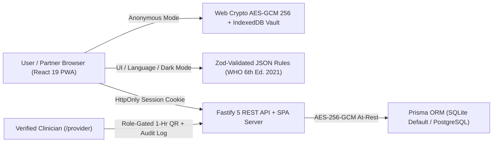

<div align="center">


# Side by Side — *"Better together."*

**Privacy-first, full-stack male reproductive health companion with local Web Crypto encryption, encrypted server sync, partner planning, and verified clinician handoff.**

[](#english)
[](#architecture--tech-stack)
[](#privacy-guarantees--medical-boundaries)

[**English**](#english) · [**Bahasa Indonesia**](#bahasa-indonesia)

</div>

---

<a id="english"></a>

## English

> **Mission:** Help men understand, check, and follow up on their reproductive health earlier—privately, without judgment, alongside their partner, and connected to trusted medical care.

Globally, **1 in 6 adults** experiences infertility in their lifetime (WHO, 2023), and male factors contribute to roughly half of cases—yet men frequently delay initial screening due to stigma, unclear clinical steps, and anxiety around testing. **Side by Side** closes that gap with a mobile-first, bilingual (`EN`/`ID`), PWA-ready workflow spanning initial self-check to lab interpretation, real-time partner collaboration, and verified clinician handoff.

### Feature Map & Bilingual Routes

Every screen adapts seamlessly across desktop, mobile, Light/Dark Mode, and `EN` / `ID` URLs:

| Module | EN Route | ID Route | Key Capability |
| :--- | :--- | :--- | :--- |
| **Welcome & Onboarding** | `/welcome` | `/sambutan` | Account-free Anonymous Mode onboarding, real account registration/sign-in & opt-in consents |
| **Home Overview** | `/home` | `/beranda` | Next-step summary card, plan progress, & upcoming checkup reminders |
| **Private Self Check** | `/assessment` | `/cek-awal` | Under-3-minute check with an **explainable, plain-language risk breakdown** (no numeric score): why this result, influence per area, factor-by-factor “what you can do”, what is already working, and what could change the result |
| **Care Pathway (Referral)** | `/care-pathway` | `/jalur-perawatan` | **Connected specialist referral pathway**: self-check → matched specialist (GP/FKTP, Sp.And, Sp.U, lab, fertility clinic, counsellor) with reasons → JKN tiered or private route → matching facility → booking & prep → printable Referral Summary → consultation log or **doctor-written post-visit plan** → after-care tasks with reminders |
| **WHO 2021 Semen Simulator** | `/semen-calculator` | `/simulator` | Interactive *Total Motile Sperm Count* (**TMSC**) & parameter comparison vs. WHO 6th Ed. |
| **72–74 Day Cycle Tracker** | `/cycle-tracker` | `/siklus-72-hari` | Tracks daily lifestyle habits across the ~74-day spermatogenesis maturation window (synced for accounts) |
| **Doctor Question Checklist** | `/doctor-checklist` | `/checklist-dokter` | Persistent consultation question builder with custom questions, copy, & PDF print |
| **Find Care** | `/facilities` | `/layanan` | Database-backed clinics/hospitals filtered by **JKN Accepted** & **Men-Friendly Score**, plus `.ics` calendar export |
| **My Results & WHO Trend** | `/results` | `/hasil` | Longitudinal semen trends vs. WHO 2021 thresholds, record editing, CSV export, & encrypted lab sheet attachments |
| **My Progress (Private)** | `/progress` | `/progres` | **Private longitudinal tracking** (consent-gated, default OFF): self-check history with what changed, 30-second monthly check-ins (sleep, stress, activity, smoking/vaping, alcohol, weight, heat, discomfort, sexual health), trend charts with plain-language summaries, TMSC over time, unified timeline, CSV export & delete |
| **Couple Mode (Our Plan)** | `/couple` | `/berdua` | Live-synced 6-step milestone tracker, shared prep checklist, & *"Invite Gently"* templates without exposing private records |
| **Library & Anonymous Q&A** | `/library` | `/pustaka` | Database-backed guides, myth-busting, & authenticated session-isolated anonymous Q&A tickets |
| **Share to Doctor (1-Hr QR)** | `/share` | `/bagikan-nakes` | Granular per-item consent scopes (incl. new *Referral Summary* and *My Progress* scopes) generating a 1-hour expiring server-signed token & live access audit log |
| **Provider Dashboard** | `/provider` | `/nakes` | Invite-gated clinician portal for verified QR summary review (incl. the patient’s plain-language breakdown, referral request & trends), **post-visit care plan sent back to the patient**, counseling templates, & answering patient tickets |
| **Account & Vault Settings** | `/account` · `/settings` | `/akun` · `/pengaturan` | Password management, encrypted vault inspector (*On-Device Encrypted Storage Proof*), JSON export & **backup restore**, & 2-step **Delete all my data** |

### System Architecture & Privacy Data Flow



### Final-Round Improvements (Reviewer Feedback)

| Reviewer feedback | What changed | Where |
| :--- | :--- | :--- |
| *Explainable plain-language risk breakdowns rather than a simple numeric score* | The rule engine is unchanged and auditable; a new explainer ([`risk-explainer.ts`](./src/lib/risk-explainer.ts)) turns answers into **reasons for the result** (red flag, time rule, or factors adding up), a **3-level influence meter in words** per area (medical / time / habits), **factor cards** (your answer, why it matters, what you can do, safety notes, “you can change this” vs “needs a doctor”), **what is already working**, and a **“what could change your result”** counterfactual. Partner age is never surfaced. | `/assessment` · [`RiskBreakdown.tsx`](./src/components/RiskBreakdown.tsx) · [`risk-explanations.ts`](./src/config/risk-explanations.ts) |
| *Connected specialist referral pathway from self-assessment through post-consultation care* | A 6-stage pathway ([`care-pathway.ts`](./src/lib/care-pathway.ts)) matches the right specialist from the answers with reasons, explains the **JKN tiered referral** (FKTP → referral → hospital) vs private route, suggests men-friendly facilities, books the visit with reminders, produces a **printable Referral Summary**, and closes the loop: the clinician opening the 1-hour QR can **send a post-visit care plan** (tests, lifestyle focus, onward referral, follow-up date) that lands in the patient’s pathway as dated tasks. Couple Mode steps update automatically. | `/care-pathway` · `/provider` · `POST /api/share-tokens/:code/care-plan` · `GET /api/care-plans` |
| *Private longitudinal tracking of reproductive health metrics over time* | A consent-gated, encrypted **health journal** ([`health-journal.ts`](./src/lib/health-journal.ts)) stores every self-check (partner data stripped) and quick monthly check-ins; the Progress page shows plain-language trends, charts with healthy ranges, what changed between self-checks, TMSC over time, and a unified timeline. Stored AES-GCM on device; in Account Mode synced as one AES-256-GCM blob (`HealthJournal` table). Never shared with a partner; a doctor sees only a trend summary if the patient adds the *My Progress* scope. | `/progress` · `HealthJournal` model · `POST /api/sync` (`journal`) |

> **Upgrading an existing install:** this release adds the `HealthJournal` table and two nullable columns on `ShareToken`. Run `npm run db:push` (or `npm run db:setup`) once after pulling. The Docker image already runs `prisma db push` on start.

### AI Assistant Features (Opt-In)

Four AI features sit on top of the rule engine. They never replace it: the risk level still comes from the auditable rules, and AI only explains, reads, drafts, and suggests.

| Feature | What it does | Where |
| :--- | :--- | :--- |
| **AI Health Companion (agent)** | Answers questions in plain words using the user's own result, pathway stage and trends. It can call tools: search the clinical library, look up WHO 2021 semen reference values, and find men-friendly facilities. It can also *suggest* a care-plan task, a reminder, or a page to open; each suggestion appears as a button and nothing changes until the user taps it. Library sources are cited. | `/companion` · `/asisten` · `POST /api/ai/companion` |
| **Lab Report Reader** | Reads a photo or PDF of a semen analysis report and fills the result form. Values outside plausible ranges are dropped and listed as “not found”; the user checks every number before saving. The file is not stored by the server. | `/results` · `POST /api/ai/lab-report` |
| **Visit Brief & Plan Explainer** | For the clinician: a one-screen pre-visit brief drafted from only the scopes the patient shared, and only if the patient ticked *Allow an AI visit brief*. Logged in the patient's access log. For the patient: “Explain this plan in plain words” on a doctor's care plan, with questions to ask next time. | `/provider` · `/care-pathway` · `POST /api/ai/visit-brief` · `POST /api/ai/explain-plan` |
| **Smarter Distress Detection** | Free-text notes (check-ins, self-check notes) are screened by keywords **and**, if AI is on, a small fast model that catches indirect phrasing. If AI fails, the keyword check still runs. A concern shows the SEJIWA `119 ext 8` support banner. | `/progress` · `/assessment` · `POST /api/ai/distress-check` |

**Setup:** add `ANTHROPIC_API_KEY` to `.env` and restart. Defaults: `AI_MODEL="claude-sonnet-5-5"` (companion, lab reader, explainer, visit brief) and `AI_FAST_MODEL="claude-haiku-5-5"` (distress check). Any OpenAI-compatible endpoint (e.g. Azure OpenAI in an Indonesian region) also works with `AI_PROVIDER="openai-compatible"`, `AI_BASE_URL`, `AI_API_KEY` and `AI_MODEL`; see [`.env.example`](./.env.example). Without a key, or with `AI_DISABLED="true"`, every AI control hides itself and the app works exactly as before. `GET /api/ai/status` reports whether AI is on.

**Guardrails:** AI is **off by default** behind a separate `ai_assist` consent (Settings → *AI Assistant Features*). Requests carry no name, email, account ID or partner age; free-text notes are not sent to the companion; the lab reader asks users to cover their name and ID first. Every prompt carries a medical boundary: no diagnosis, no medication, supplement or dosage advice, and emergencies are pointed to IGD / `119`. Agent actions are allow-listed and user-confirmed. Routes are rate-limited, provider errors are never passed through, and chats are kept in memory only. Code: [`server/ai.ts`](./server/ai.ts) (providers, prompts, tools) and [`server/ai-routes.ts`](./server/ai-routes.ts).

<a id="running-locally"></a>

### Running in Development & Production

**Prerequisites:** Node.js `20+` (Docker uses `node:22-alpine`) and `npm`.

```bash
# 1. Install dependencies
npm install

# 2. Configure environment
cp .env.example .env
# Edit SESSION_SECRET, ENCRYPTION_KEY, and NAKES_INVITE_CODE in .env for production

# 3. Initialize database & seed curated care facilities and clinical articles
npm run db:setup

# 4. Run development mode (Fastify API on :3001 + Vite HMR on :5173)
npm run dev

# 5. Build and run unified production server (Fastify serves both /api/* and built dist/ SPA on :3001)
npm run build
npm start

# 6. Optional: Provision a verified Healthcare Provider account via CLI
npx tsx server/create-provider.ts doctor@clinic.id "StrongPass123!" "Dr. Hendra, Sp.And"

# 7. Run all automated unit, integration, security, and accessibility tests
npm test
```

<details>
<summary><strong>Environment variables (<code>.env.example</code>) & Production Docker</strong></summary>

- `DATABASE_URL`: Defaults to `"file:./dev.db"` (SQLite) for single-node setups; switch `provider` in [`prisma/schema.prisma`](./prisma/schema.prisma) to `"postgresql"` and supply `postgresql://...` for multi-instance production.
- `SESSION_SECRET` / `ENCRYPTION_KEY`: Required secrets for signing `httpOnly` session cookies and encrypting sensitive database payloads at rest (`AES-256-GCM`).
- `NAKES_INVITE_CODE`: Access code required when registering a Healthcare Provider (`nakes`) account via `/provider` or `/account`.
- `PORT` / `HOST` / `CORS_ORIGIN`: Backend defaults to `3001`, `0.0.0.0`, and `http://localhost:5173`.
- `ANTHROPIC_API_KEY` (optional): turns on the opt-in AI features. `AI_MODEL` / `AI_FAST_MODEL` override the models; `AI_PROVIDER="openai-compatible"` with `AI_BASE_URL` / `AI_API_KEY` uses another provider; `AI_DISABLED="true"` switches AI off.

```bash
# Build and run unified production container
docker build -t side-by-side .
docker run -p 3001:3001 \
  -e SESSION_SECRET="your-32-char-session-secret" \
  -e ENCRYPTION_KEY="your-32-char-encryption-key" \
  -e NAKES_INVITE_CODE="your-clinic-invite-code" \
  side-by-side
```

</details>

<a id="architecture--tech-stack"></a>

### Architecture & Tech Stack

| Layer | Implementation Details |
| :--- | :--- |
| **Frontend & UI** | `React 19`, `TypeScript 5.7`, `Vite 6`, `React Router 7`, `TanStack Query 5`, `Tailwind CSS 3`, `Lucide React`, `qrcode.react` |
| **Backend API & Auth** | `Fastify 5` (`@fastify/cookie`, `@fastify/cors`, `@fastify/helmet`, `@fastify/rate-limit`) with `scrypt` password hashing, signed `httpOnly` sessions, and production SPA hosting in [`server/index.ts`](./server/index.ts) |
| **Encryption** | Client-side Web Crypto `AES-GCM` 256-bit (`IndexedDB`) + Server-side `AES-256-GCM` at-rest encryption ([`server/crypto-auth.ts`](./server/crypto-auth.ts)) |
| **Database & ORM** | `Prisma 6` targeting SQLite (`file:./dev.db`) by default, portable to PostgreSQL via `DATABASE_URL` |
| **Clinical Rules Engine** | Declarative configs ([`assessment-rules.json`](./src/config/assessment-rules.json), [`semen-reference.json`](./src/config/semen-reference.json)) validated by Zod schemas ([`schemas.ts`](./src/config/schemas.ts)) |
| **AI (optional)** | Anthropic Messages API (`claude-sonnet-5-5`, `claude-haiku-5-5`) with tool use, or any OpenAI-compatible endpoint; server-side only, called through a thin provider layer with no SDK dependency |
| **Testing** | `Vitest 3` + `Testing Library` + `jsdom` across unit, backend security/encryption, privacy, and accessibility suites |

<a id="privacy-guarantees--medical-boundaries"></a>

### Privacy Guarantees & Medical Boundaries

- **Indonesian PDP Law (`UU PDP`) Alignment:** Granular consent toggles (`store_results`, `share_partner`, `share_nakes`) default to **OFF**. Raw Anonymous Mode inputs stay encrypted locally (`AES-GCM` 256-bit), and synced server records are encrypted at rest (`AES-256-GCM`). Service Worker explicitly bypasses `/api/*` routes so private clinical API payloads are never cached.
- **Anti-Leakage Rules:** Even when trying duration (> 12 months, or > 6 months with female partner ≥ 35) triggers `within_1_2_months`, the UI never leaks female partner age in factor explanations or partner views.
- **Role & Ownership Guards:** Partner privacy switches are strictly locked to Partner A (`user_a`), anonymous Q&A replies and 1-hour patient QR lookups require an authenticated `nakes` session, and clinicians register only with `NAKES_INVITE_CODE` (or CLI provisioning).
- **2-Step Full Data Erasure:** **`Delete all my data`** in `/settings` or `/account` wipes both local browser storage (`IndexedDB` / `localStorage`) and all server records (including the encrypted health journal and clinician care plans) via `DELETE /api/users/:userId/data`.
- **Consent-Gated History:** Self-check history and check-ins are recorded only when `store_results` consent is ON (default OFF), can be stopped or deleted from `/progress`, and never include partner details or free-text notes in what a clinician sees.
- **Clinician Write-Back Limits:** Only verified `nakes` sessions can write a post-visit care plan, only for non-revoked codes, within 24 hours of the code being created; every write is logged in the patient-visible audit log and encrypted at rest.
- **AI Is Opt-In and Minimal:** AI features need their own `ai_assist` consent (default OFF), send no identity data, never store chats or uploaded lab files, and only suggest actions the user must confirm. Clinician visit briefs require the patient's separate tick on the QR code and are audit-logged.
- **Non-Diagnostic Medical Boundary:** Side by Side provides educational guidance and care navigation only—zero diagnosis, treatment claims, fertility guarantees, or medication/dosage/supplement recommendations. Free-text entries screen for severe emotional distress and surface the Indonesian Ministry of Health **SEJIWA** hotline (`119 ext 8`).

---

<a id="bahasa-indonesia"></a>

## Bahasa Indonesia

*[↑ Back to Top / English](#english)*

> **Misi:** Membantu pria memahami, memeriksakan, dan menindaklanjuti kesehatan reproduksinya lebih awal—secara privat, tanpa penghakiman, bersama pasangan, dan terhubung ke layanan medis tepercaya.

Secara global, **1 dari 6 orang dewasa** mengalami infertilitas sepanjang hidupnya (WHO, 2023), dengan faktor pria berkontribusi pada sekitar separuh kasus—namun pria sering menunda pemeriksaan awal akibat stigma, ketidakjelasan langkah pemeriksaan, dan rasa cemas. **Side by Side** menjembatani hal ini lewat aplikasi web full-stack dwi-bahasa (`ID`/`EN`) yang siap produksi dari tahap cek awal hingga interpretasi hasil lab, kolaborasi pasangan waktu nyata, serta serah terima klinis terverifikasi ke dokter.

### Penyempurnaan Babak Final (Masukan Juri)

- **Rincian risiko yang dapat dijelaskan** (`/cek-awal`): alasan hasil, meter pengaruh berbentuk kata (bukan skor), rincian per faktor beserta “yang bisa Anda lakukan”, hal yang sudah baik, dan “apa yang bisa mengubah hasil Anda”.
- **Jalur rujukan spesialis terhubung** (`/jalur-perawatan`): Cek Awal → spesialis yang tepat & alasannya → jalur JKN berjenjang atau mandiri → fasilitas → jadwal & persiapan → Ringkasan Rujukan → catatan konsultasi atau **rencana pasca-kunjungan yang dikirim dokter** → perawatan lanjutan dengan pengingat.
- **Pelacakan longitudinal privat** (`/progres`): riwayat Cek Awal, check-in bulanan 30 detik, grafik tren dengan ringkasan bahasa awam, TMSC dari waktu ke waktu—terenkripsi dan hanya aktif dengan persetujuan.
- **Pembaruan instalasi lama:** jalankan `npm run db:push` sekali setelah menarik kode terbaru.

### Fitur Asisten AI (Opsional, Atas Persetujuan)

- **Pendamping Kesehatan AI (agen)** (`/asisten`): menjawab pertanyaan dengan bahasa awam berdasarkan hasil, tahap jalur, dan tren pengguna; dapat mencari Pustaka, nilai rujukan WHO 2021, dan faskes ramah pria; menyarankan tugas, pengingat, atau halaman sebagai tombol—tidak ada yang berubah sebelum pengguna menekannya.
- **Pembaca Laporan Lab** (`/hasil`): membaca foto/PDF hasil analisis semen dan mengisi formulir; pengguna memeriksa setiap angka sebelum menyimpan. Berkas tidak disimpan server.
- **Ringkasan Kunjungan & Penjelas Rencana**: ringkasan pra-kunjungan untuk dokter hanya bila pasien mencentang izinnya (tercatat di log akses), serta penjelasan rencana dokter dalam kata sederhana untuk pasien.
- **Deteksi Distres Lebih Cermat**: catatan bebas diperiksa kata kunci dan model AI cepat; bila perlu, banner dukungan SEJIWA `119 ext 8` muncul.
- **Pengaturan:** isi `ANTHROPIC_API_KEY` di `.env` (model bawaan `claude-sonnet-5-5` dan `claude-haiku-5-5`, atau endpoint kompatibel OpenAI). Tanpa kunci, semua fitur AI tersembunyi. AI **nonaktif secara bawaan** dan perlu persetujuan `ai_assist` di Pengaturan; tidak mengirim nama, email, ID, atau usia pasangan; tidak mendiagnosis atau menyarankan obat.

### Cara Menjalankan (Pengembangan & Produksi)

```bash
# 1. Instal dependensi
npm install

# 2. Salin & sesuaikan konfigurasi environment (.env)
cp .env.example .env

# 3. Inisialisasi database & seed direktori faskes serta artikel edukasi klinis
npm run db:setup

# 4. Mode pengembangan (Fastify API :3001 + Vite HMR :5173)
npm run dev

# 5. Build & jalankan server produksi terpadu (Fastify melayani /api/* dan SPA dist/ pada port 3001)
npm run build
npm start

# 6. Opsional: Buat akun Tenaga Kesehatan (Nakes) langsung lewat CLI
npx tsx server/create-provider.ts dokter@klinik.id "KataSandiKuat123!" "dr. Hendra, Sp.And"

# 7. Jalankan seluruh pengujian otomatis
npm test
```
